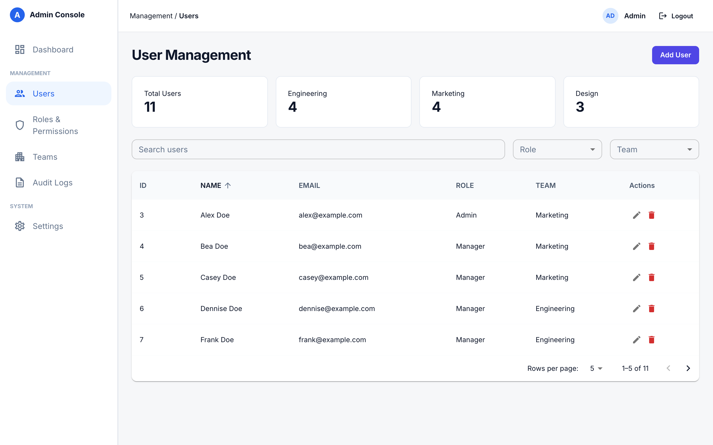

# User Management System

An admin console for managing users. You can search and filter users, sort and page through them, and add, edit or delete them. The page also shows user counts by team.



## Tech stack

| | |
|---|---|
| **API** (`user-management-api/`) | Java 21, Spring Boot 4, Spring Data REST, Spring Security, QueryDSL, H2 (in-memory), Lombok, Maven |
| **Web** (`user-management-web/`) | React 19, TypeScript, Vite, MUI, TanStack Query, React Router, React Hook Form + Zod, Vitest + Testing Library + MSW |

## Getting started

### Prerequisites

- JDK 21
- Node.js 22+

### 1. Start the API

```bash
cd user-management-api
./mvnw spring-boot:run
```

The API runs on http://localhost:8080. It uses an in-memory H2 database that is reloaded with sample users from `src/main/resources/data.sql` each time it starts, so any changes are lost on restart.

### 2. Start the web app

```bash
cd user-management-web
npm install
npm run dev
```

Open http://localhost:5173. The Vite dev server forwards `/api/*` requests to the API.

### 3. Sign in

| Email | Password |
|---|---|
| `admin@example.com` | `admin` |

To change the password, set `app.admin.password` in `application.properties`, or pass `--app.admin.password=...` when you start the API.

## API overview

All endpoints except `/auth/csrf` and `/auth/login` require a session. Any request other than GET, HEAD or OPTIONS must also send the CSRF token returned by `GET /auth/csrf`.

| Method | Path | Description |
|---|---|---|
| `GET` | `/auth/csrf` | Get a CSRF token (`headerName`, `token`) |
| `POST` | `/auth/login` | Form login (`username`, `password`, form-encoded) |
| `POST` | `/auth/logout` | End the session |
| `GET` | `/auth/me` | The signed-in user |
| `GET` | `/users` | List users (HAL). Supports `name`, `role` and `team` filters (case-insensitive contains), plus `page`, `size` and `sort=field,asc\|desc` |
| `POST` | `/users` | Create a user |
| `GET` / `PATCH` / `DELETE` | `/users/{id}` | Get, update or delete a user |
| `GET` | `/user-summary` | Total users and counts for Engineering, Marketing and Design |

Spring Data REST generates the `/users` endpoints from the repository. Emails are trimmed, lowercased and must be unique; a duplicate returns:

```json
409 { "code": "EMAIL_ALREADY_EXISTS", "field": "email", "message": "..." }
```

## Development

### API

```bash
./mvnw test                           # run tests
./mvnw test -Dtest=ClassName#method   # run a single test
```

### Web

```bash
npm run lint       # ESLint
npm run test:run   # run tests once (npm test for watch mode)
npm run build      # type-check and production build
```

## Project structure

```
user-management-api/   Spring Boot backend
  config/              Security (session + CSRF) and REST config
  controller/          /auth and /user-summary endpoints
  handler/             Validation that runs before users are created or saved (email uniqueness)
  repository/          UserRepository (exposed as /users)
user-management-web/   React frontend
  src/api/             Fetch helpers (apiFetch attaches the CSRF token)
  src/hooks/           TanStack Query hooks
  src/pages/           Login and Users pages
  src/components/      Table, dialogs, layout, route guard
docs/                  Screenshots
```

Only the **Users** page is implemented. Dashboard, Roles & Permissions, Teams, Audit Logs and Settings are placeholders.
